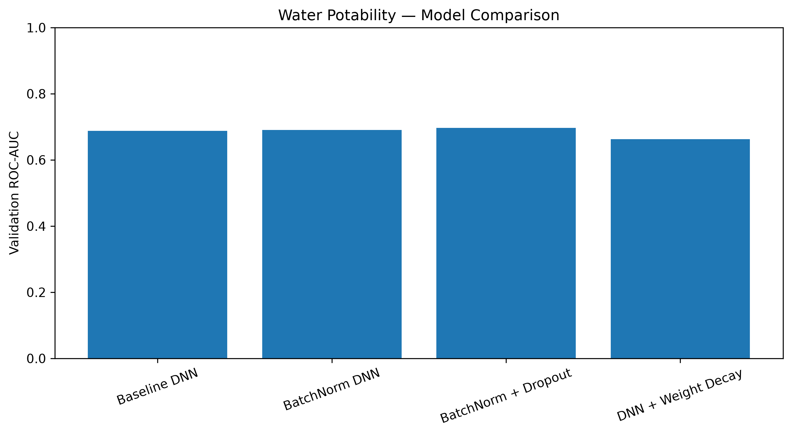
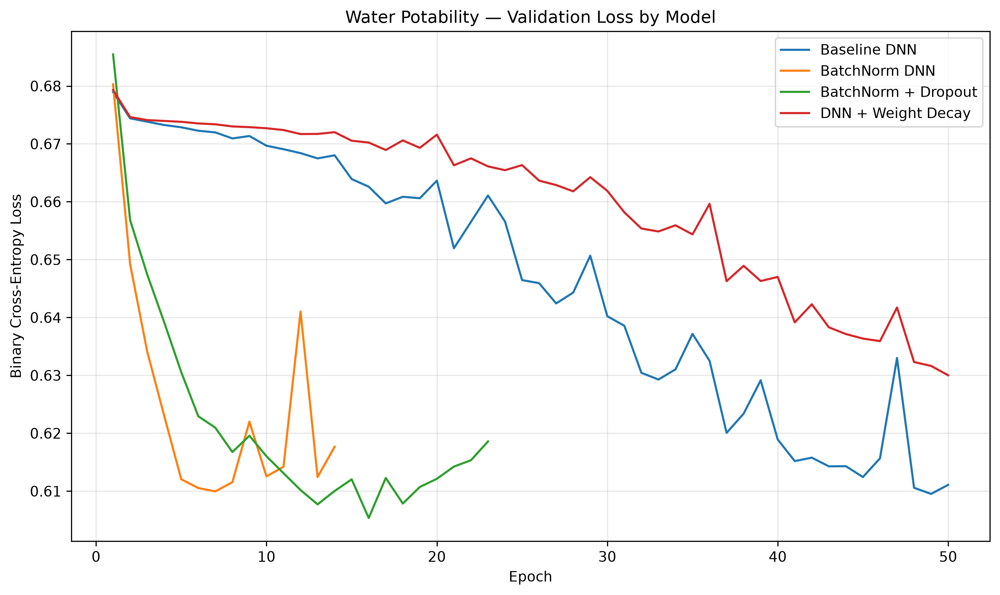

# Water Potability Prediction using PyTorch

A deep learning project investigating the prediction of water potability from physicochemical measurements using fully connected neural networks implemented in PyTorch.

The project demonstrates an end-to-end machine learning workflow, including data preparation, custom PyTorch datasets, neural network development, regularisation, model comparison, early stopping and independent test evaluation.

## 1. Project Objectives

- Develop a binary classifier to predict water potability.
- Implement custom `Dataset` classes and PyTorch `DataLoader` objects.
- Build deep neural networks using `nn.Module`.
- Compare batch normalisation, dropout and weight decay.
- Implement reusable training and evaluation functions.
- Evaluate model generalisation using a held-out test dataset.

## 2. Dataset

The dataset contains nine physicochemical water measurements:

- pH
- Hardness
- Solids
- Chloramines
- Sulfate
- Conductivity
- Organic carbon
- Trihalomethanes
- Turbidity

The target variable, `Potability`, is binary:

- `0`: Not potable
- `1`: Potable

**Dataset partitioning**

| Dataset | Samples |
|---|---:|
| Training | 1,206 |
| Validation | 302 |
| Test | 503 |
| Total | 2,011 |

The supplied data contained no missing values, and the features appeared to be previously scaled. The original preprocessing and scaling procedure has not been independently verified.

## 3. Neural Network Architectures

Four model configurations were investigated:

| Model | Configuration |
|---|---|
| Baseline DNN | 9 → 64 → 32 → 1, ReLU |
| BatchNorm DNN | Baseline architecture with batch normalisation |
| BatchNorm + Dropout | Batch normalisation and dropout (p = 0.2) |
| DNN + Weight Decay | Baseline architecture with weight decay of 0.001 |

All models used binary cross-entropy with logits (`BCEWithLogitsLoss`) and the Adam optimiser, with a learning rate of 0.001.

Training used mini-batches of 32 samples, up to 50 epochs, and early stopping with a patience of seven epochs.

## 4. Validation Results

| Model | Accuracy | Macro F1 | ROC-AUC |
|---|---:|---:|---:|
| Baseline DNN | 0.6821 | 0.6248 | 0.6874 |
| BatchNorm DNN | 0.6854 | 0.6178 | 0.6909 |
| BatchNorm + Dropout | 0.6689 | 0.6068 | 0.6967 |
| DNN + Weight Decay | 0.6523 | 0.5804 | 0.6626 |





The BatchNorm model was selected for final evaluation because it produced the fewest false-safe predictions on the validation set at the predefined 0.5 classification threshold.

## 5. Final Test Results

The selected model was evaluated on 503 held-out test samples.

| Metric | Result |
|---|---:|
| Accuracy | 65.61% |
| Macro F1-score | Approximately 0.60 |
| ROC-AUC | 0.6685 |

**Confusion matrix**

| Actual / Predicted | Not Potable | Potable |
|---|---:|---:|
| Not Potable | 256 | 41 |
| Potable | 132 | 74 |

The results indicate moderate predictive discrimination. In particular, 41 non-potable samples were incorrectly classified as potable.

## 6. Project Structure

```text
Water-Potability-PyTorch/
├── data/
├── notebooks/
│   ├── 01_data_exploration.ipynb
│   └── 02_model_comparison.ipynb
├── src/
│   ├── dataset.py
│   ├── model.py
│   ├── train.py
│   └── evaluate.py
├── models/
│   ├── baseline_dnn.pt
│   ├── final_batchnorm_dnn.pt
│   └── final_test_metrics.json
├── images/
│   ├── model_comparison.png
│   └── validation_loss_comparison.png
└── README.md
```

## 7. Technologies

- Python
- PyTorch
- pandas and NumPy
- scikit-learn
- Matplotlib
- Jupyter Notebook
- VS Code

## 8. Key Findings

- The baseline DNN achieved competitive classification performance despite its relatively simple architecture.
- Batch normalisation accelerated optimisation but did not consistently improve generalisation.
- Dropout changed training behaviour but did not improve classification performance at the selected threshold.
- Weight decay did not improve performance with the configuration tested.
- Early stopping helped prevent retaining models from later, poorer-performing epochs.
- Model architecture and classification threshold should be selected according to appropriate validation objectives.

## 9. Limitations

The dataset is relatively small, and the models demonstrate limited predictive discrimination. The supplied preprocessing procedure has not been fully verified, and model comparisons were based on a single controlled random seed.

These results are intended for educational and experimental machine learning purposes only. **The models must not be used to determine whether drinking water is safe for human consumption.**

## 10. Future Work

Potential improvements include repeated experiments across different random seeds, comparisons with classical machine learning models, additional hyperparameter tuning and further investigation of feature importance.

The final test dataset should remain reserved for independent evaluation rather than further model tuning.